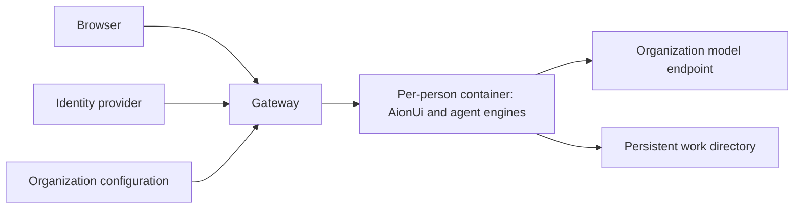

# WorkPartner

English | [中文](README.zh.md)

WorkPartner gives each person an isolated AI workspace with a web interface, persistent files, and Claude Code or Codex as the agent engine. A gateway authenticates people, routes them to their own containers, and keeps model credentials outside the browser. AionUi supplies the web interface; its distribution is downloaded during image builds rather than stored in this repository.



## Quick deployment

Use a Linux host with Docker, Node.js 24, Python 3, outbound HTTPS, a domain with TLS termination, and your own identity application and model endpoint. See [deployment](docs/deployment.md) for mounts and privileges.

1. Copy `org/default` to a separate directory and fill in your deployment values as described in [organization configuration](docs/organization.md).
2. Run Linux checks with Python PyYAML available: `bash tools/check.sh`. For an isolated environment, run `python3 -m venv /tmp/workpartner-check-env`, install `PyYAML==6.0.3` with its `bin/python -m pip`, and prepend its `bin` directory to `PATH`.
3. Download and verify the pinned build inputs, then build the user image:

   ```sh
   python3 -I tools/download-inputs.py image/third-party.lock.json /tmp/workpartner-inputs
   WORKPARTNER_ORG_DIR="$ORG_DIR" PKG=/tmp/workpartner-inputs sh image/build.sh workpartner-user:local
   WORKPARTNER_TEST_IMAGE=workpartner-user:local bash tools/check.sh
   docker build -f gateway/Dockerfile -t workpartner-gateway:local .
   ```

4. Mount your organization configuration and persistent data into the gateway, set `WORKPARTNER_ORG_DIR`, and expose only the gateway behind HTTPS. Keep user containers on private networks without published ports.

Set `ORG_DIR` to the absolute path of the organization directory prepared in step 1. The gateway supplies model defaults and the picker catalog at runtime. Later model-configuration changes replace idle personal containers without rebuilding the image. Appearance remains a build input; see [organization configuration](docs/organization.md).

## Repository map

| Directory | Purpose |
| --- | --- |
| `gateway/` | Identity login, sessions, admission and per-person routing |
| `image/` | User image, startup, neutral appearance and agent templates |
| `tools/` | Source checks and verified third-party downloads |
| `org/default/` | Neutral organization configuration |
| `docs/` | Deployment and configuration reference |

Image publication runs only for `v*` tags and publishes `ghcr.io/soundworkbench/workpartner:<tag>`. Pull requests run Linux checks without publishing. Third-party programs retain their own licenses; review their redistribution terms before publishing an image.

[Follow the exact isolated preview startup and acceptance steps](docs/deployment.md#start-an-isolated-preview).
