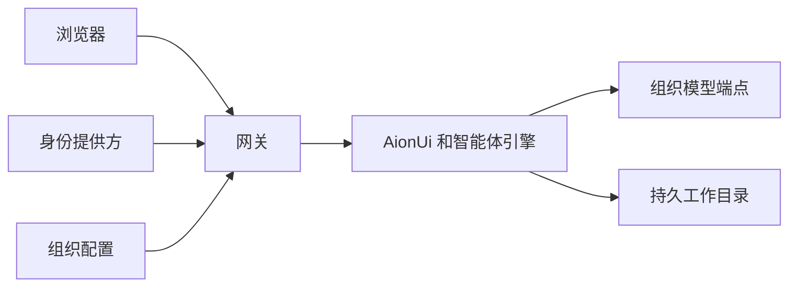

# 工作伙伴

[English](README.md)

工作伙伴为每个人提供独立的 AI 工作空间，包括网页界面、持久文件和 Claude Code 或 Codex 引擎。网关负责身份验证、按人路由和容器管理，模型凭据不会交给浏览器。网页界面由 AionUi 提供，构建时下载发行包，仓库不存放第三方二进制。



## 快速部署

准备 Linux 主机、Docker、Node.js 24、Python 3、可访问外网的 HTTPS 连接、带 TLS 的域名，以及自己的登录应用和模型端点。[部署参考](docs/deployment.md)说明挂载和权限要求。

1. 将 `org/default` 复制到单独的目录，按[组织配置说明](docs/organization.md)填写部署参数。
2. 运行 Linux 检查：`bash tools/check.sh`。
3. 下载并校验固定版本的构建输入，再构建每人镜像：

   ```sh
   python3 -I tools/download-inputs.py image/third-party.lock.json /tmp/workpartner-inputs
   PKG=/tmp/workpartner-inputs sh image/build.sh workpartner-user:local
   docker build -f gateway/Dockerfile -t workpartner-gateway:local .
   ```

4. 将组织配置和持久数据挂进网关，设置 `WORKPARTNER_ORG_DIR`，仅将网关放在 HTTPS 反向代理之后。每人容器使用私有网络，不映射端口。

## 目录

| 目录 | 用途 |
| --- | --- |
| `gateway/` | 登录、会话、准入和按人路由 |
| `image/` | 每人镜像、启动脚本、中性外观和智能体模板 |
| `tools/` | 源码检查和经过校验的第三方下载 |
| `org/default/` | 中性组织配置 |
| `docs/` | 部署与配置参考 |

只有 `v*` 标签触发镜像发布，地址为 `ghcr.io/soundworkbench/workpartner:<tag>`。合并请求运行 Linux 检查，不发布。第三方程序沿用各自许可，发布镜像前应核对其分发条款。

[按隔离预览的完整步骤启动并验收](docs/deployment.md#start-an-isolated-preview)。需要管理员提供独立测试域名、现有测试应用和模型钥匙。
